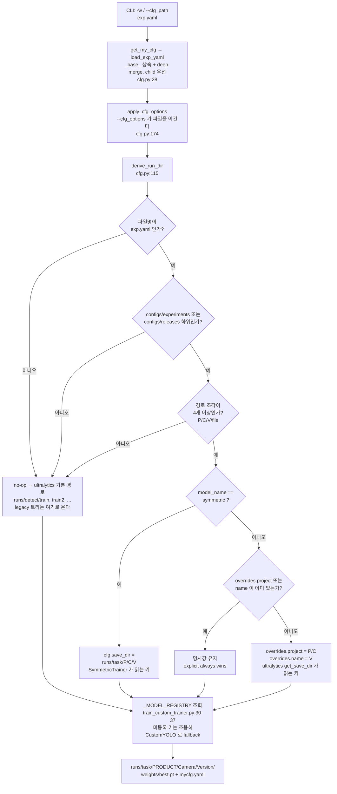
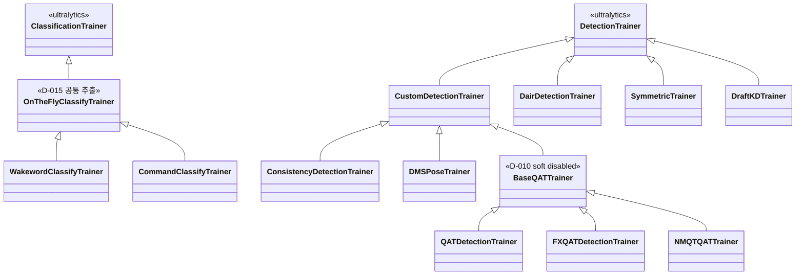

# 구조 다이어그램

`configs/` → 학습 → export → NPU 변환 경로를 세 장으로 나눠 그린다. 코드에서 직접
읽어 작성했으며, 각 노드 옆의 경로가 근거다.

관련 문서: [CLAUDE.md](../CLAUDE.md) · [technical_doc.md](technical_doc.md) ·
[debug/20260729_config_canonicalization.md](debug/20260729_config_canonicalization.md)

---

## 1. Config 해석과 trainer 분기

`tools/train_custom_trainer.py:main`(57–68행)이 config를 읽어 출력 경로를 정하고
trainer를 고르는 순서. 핵심은 `derive_run_dir`
(`projects/custom_utils/cfg.py:115`)의 **세 개의 gate** 로, 하나라도 통과하지
못하면 조용히 no-op이 되어 ultralytics 기본 경로(`runs/detect/train`,
`train2`, …)로 떨어진다.

### `model_name` → (Model, Trainer) 실제 등록표

`tools/train_custom_trainer.py:30-37` 원문. **`.get(model_name, (CustomYOLO,
CustomDetectionTrainer))` 이므로 오타나 미등록 키는 예외 없이 기본값으로
떨어진다** — 아키텍처가 조용히 바뀌므로 값을 넣을 때 이 표와 대조할 것.

| `model_name` | Model | Trainer | 사용 횟수 |
|---|---|---|---|
| `custom` | `CustomYOLO` | `CustomDetectionTrainer` | 23 |
| `consi` | `ConsistencyYOLO` | `ConsistencyDetectionTrainer` | 24 |
| `dair` | `DairYOLO` | `DairDetectionTrainer` | 13 |
| `dms_pose` | `DMSPoseYOLO` | `DMSPoseTrainer` | 5 |
| `qat` | `QATYOLO` | `QATDetectionTrainer` | 6 |
| `fx_qat` | `FXQATYOLO` | `FXQATDetectionTrainer` | 5 |
| `symmetric` | `SymmetricYOLO` | `SymmetricTrainer` | 3 |

---

## 2. Trainer 상속 구조

두 계열이 완전히 분리돼 있다. detect 계열은 `CustomDetectionTrainer` 아래로
모이지만 `DairDetectionTrainer` 와 `SymmetricTrainer` 는 ultralytics
`DetectionTrainer` 를 직접 상속한다 — `derive_run_dir` 가 `symmetric` 만
특수 처리하는 이유이자, dair 계열 변경이 custom 계열에 전파되지 않는 이유다.

정의 위치 — `CustomDetectionTrainer` `custom.py:30` ·
`DairDetectionTrainer` `dair.py:36` · `SymmetricTrainer` `symmetric.py:61` ·
`BaseQATTrainer` `base_qat.py:36` ·
`OnTheFlyClassifyTrainer` `projects/src/ncnvox/_base_trainer.py:24`. detect 계열은
모두 `projects/src/models/yolo/detect/train/` 하위다.

`BaseQATTrainer` 계열(`QATDetectionTrainer` · `FXQATDetectionTrainer` ·
`NMQTQATTrainer`)은 D-010에 따라 soft disable 상태이며 **삭제하지 않는다**.

---

## 3. 학습 → export → NPU 변환

`runs/` 의 `best.pt` 가 CNN25 바이너리가 되기까지의 경로. 점선은 선택 단계다.
`novatek/convert/run_pipeline.sh` 는 compile → simulate → visualize 세 단계를
순서대로 호출하며, **중간 단계를 건너뛰면 조용히 실패한다**(D-016) — 반드시
wrapper 로만 실행한다.

```mermaid
flowchart LR
    subgraph train["학습 (dair-train 컨테이너)"]
        CFG["configs/.../exp.yaml"]
        TRAIN["tools/train_custom_trainer.py<br/>또는 dist_train_custom.sh"]
        PT["runs/task/P/C/V/<br/>weights/best.pt"]
        VAL["tools/validate_custom.py<br/>PyTorch val 기준선"]
    end

    subgraph export["ONNX export"]
        EXP["tools/export_custom.py<br/>export_dms.py / export_symmetric.py"]
        FUSE["tools/fuse_mean_std_norm.py<br/>정규화를 첫 Conv 에 융합"]
        ONNX["float ONNX<br/>dbox + scores"]
    end

    subgraph npu["NPU 변환 (npu-convert 컨테이너)"]
        WORK["novatek/convert/model_dir/nvtai_tool/<br/>config-dir + input/data/PATTERN"]
        PIPE["run_pipeline.sh"]
        COMP["run_compiler.sh<br/>compiler.nvtai --chip 530"]
        BIN["nvtai_tool/output/PATTERN/<br/>NPU 바이너리"]
        SIM["run_simulator.sh<br/>simulator.nvtai emu530"]
        VIS["visualize_sim.py"]
    end

    CMP["시뮬레이터 결과 vs<br/>PyTorch val 기준선 대조"]

    CFG --> TRAIN --> PT
    PT --> VAL
    PT --> EXP --> ONNX
    EXP -.-> FUSE -.-> ONNX
    ONNX --> WORK --> PIPE
    PIPE --> COMP --> BIN
    PIPE --> SIM
    BIN --> SIM --> VIS --> CMP
    VAL --> CMP
```

`model_dir` 이름은 대문자로 변환돼 `--pattern-name` 이 된다
(`front_260401` → `FRONT_260401`, `run_compiler.sh:36-37`). 시뮬레이터는
`nvtai_tool/input/data/PATTERN/test_img_list.txt` 를 읽으므로, 이 파일이 없으면
compile은 성공하고 simulate만 실패한다.
