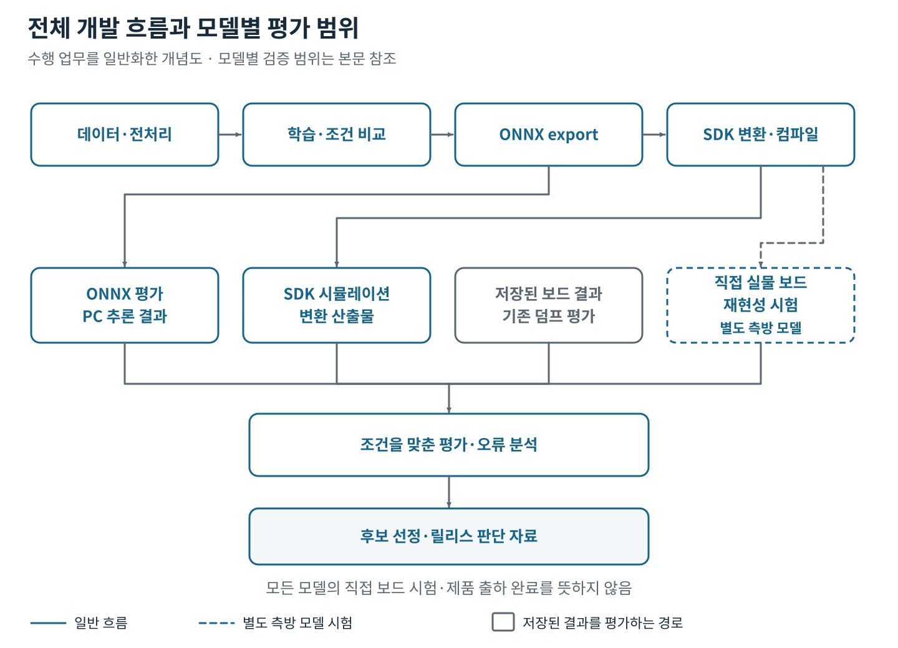
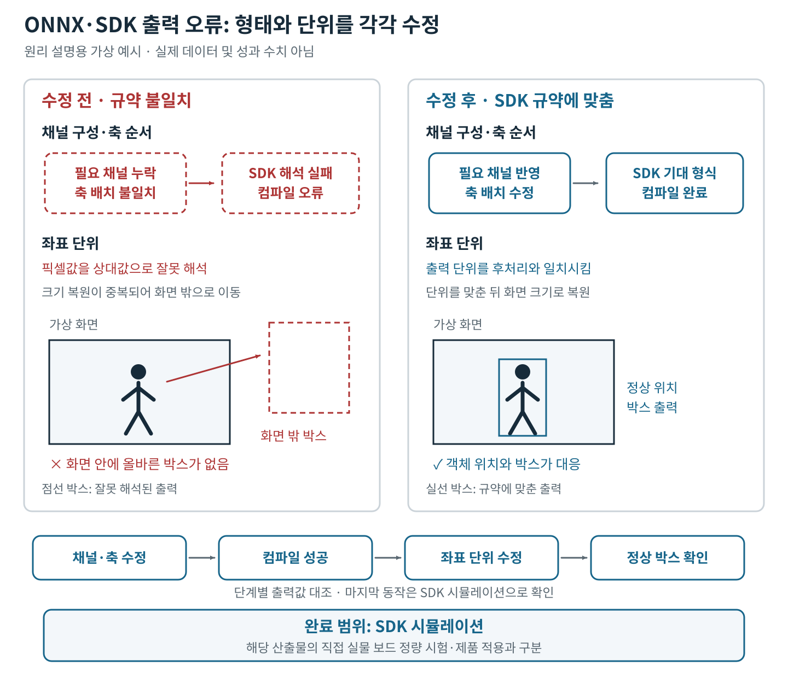
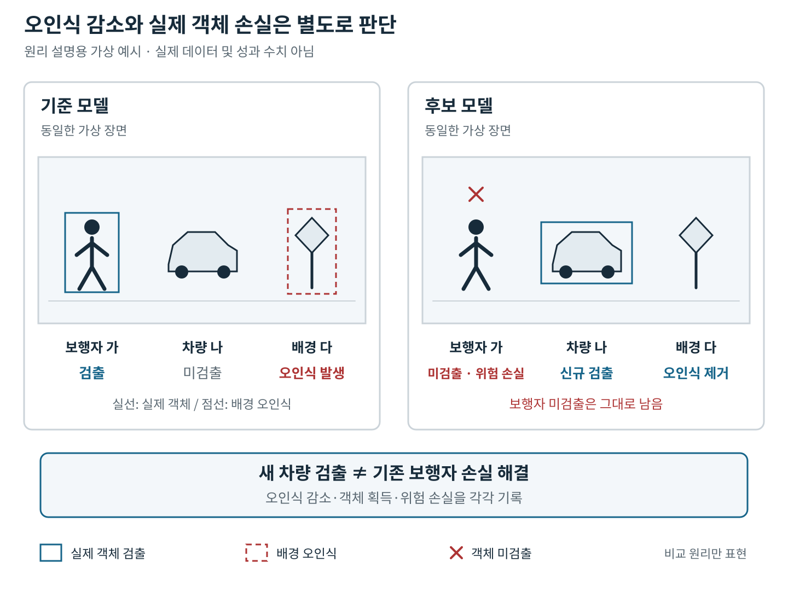

# 객체 탐지 모델을 학습에서 임베디드 실행·평가까지 연결한 경험

이름: ______  
연락처: ______  
참여 기간: ______  
직책: ______  
조직명: ______  
팀 규모: ______  
협업 범위: ______

## 소개와 핵심 역량

객체 탐지 모델의 데이터 전처리와 학습부터 ONNX export, 임베디드 변환과 평가까지 연결해 담당했습니다. 모델의 성능 차이를 학습 조건, 가중치, 입출력 규약과 평가 방식으로 나눠 추적하고, 실험 결과를 후보 선정과 릴리스 판단 근거로 연결했습니다.

핵심 역량은 모델과 실행 환경 사이의 오류를 좁히는 일, 비교 가능한 평가 조건을 만드는 일, 개선 효과와 남은 위험을 함께 판단하는 일입니다. 컴파일 성공 뒤에도 남아 있던 좌표 오류를 해결했고, 오인식 감소 뒤에 가려진 실제 객체 손실을 분석해 후보 교체 판단에 반영했습니다.

## 담당 업무와 전체 개발 흐름

- **모델 학습·비교:** 기준 모델 재학습과 미세조정, 학습 조건 변경 실험을 수행했습니다. ONNX 출력과 양자화 이후 레이어별 오차를 대조해 학습 조건의 영향과 측정 방식의 영향을 분리했습니다. 양자화는 모델을 제한된 정밀도로 계산하도록 변환하는 과정입니다.
- **변환·추론 오류 해결:** ONNX와 SDK 후처리 사이의 출력 채널·축 순서·좌표 단위를 대조하고 그래프를 수정했습니다. ONNX는 모델을 실행 환경 사이에 전달하는 형식이며, SDK는 대상 장치의 변환·실행 도구 모음입니다.
- **평가·설정 통합:** 분산된 평가 경로를 통합하고 좌표 변환과 클래스 매핑을 공통화했습니다. 클래스 매핑은 서로 다른 객체 분류 이름·번호를 대응시키는 처리입니다. 실험 입력과 자동 실행 기록을 분리해 설정 복사 시 과거 출력 위치가 재사용되는 문제도 해소했습니다.
- **산출물 추적·재현성 시험:** 그래프·가중치·원시 출력을 대조해 같은 구조의 릴리스 모델과 체크포인트가 서로 다른 가중치임을 식별했습니다. 별도의 측방 탐지 모델에서는 재변환 바이너리를 직접 실물 보드에 실행하고, 공통 이미지·클래스·점수 하한을 맞춰 기존 검출 결과와 비교했습니다.
- **후보 판단:** 자동 평가에 더해 모델 간 결과가 갈리는 객체의 육안 판정과 연속 영상 분석을 수행했습니다. 오인식 감소와 실제 객체 손실을 함께 제시하고, 미검증 범위와 잔여 위험을 릴리스 판단 자료에 남겼습니다.

다음 도식은 담당 업무의 관계를 설명합니다. 실물 보드 시험은 모델별로 별도 수행한 단계입니다.

[PNG 보기](assets/development_flow.png)

그림 1. 평가 경로를 구분해 후보 선정·릴리스 판단 자료로 연결합니다. 직접 실물 보드 재현성 시험은 별도 측방 모델의 가지입니다.

*수행 업무를 일반화한 개념도 · 모델별 검증 범위는 본문 참조*

| 단계 | 수행 범위 |
|---|---|
| 학습·실험 | 객체 탐지 모델의 재학습·미세조정과 조건 비교 |
| SDK 시뮬레이션 | 사례 A의 변환 산출물과 박스 출력 시험 |
| 저장된 보드 결과 평가 | 사례 B의 후보 비교와 후속 객체 판정 |
| ONNX 영상 분석 | 사례 B의 미검출 지속성과 실행 환경 차이 조사 |
| 직접 실물 보드 시험 | 별도 측방 탐지 모델의 재변환 결과와 기존 덤프 비교 |
| 릴리스·제품 적용 | 후보 선정·릴리스 준비 자료 작성 경험과 실제 제품 적용은 구분하며, 아래 사례의 결과로 제품 탑재·출하를 주장하지 않음 |

## 사례 A — ONNX·SDK 출력 규약 불일치 해결

### 해결하려던 문제

객체 탐지 모델을 SDK 실행 형식으로 변환하는 과정에서 컴파일이 실패했습니다. 출력 형태를 수정한 뒤에는 컴파일이 끝났지만 화면에 검출 박스가 나타나지 않았습니다. 변환 절차를 끝내는 것과 올바른 추론 결과를 얻는 것은 다른 문제였습니다.

### 기술적 제약

모델 출력과 SDK 후처리가 기대하는 데이터 형식이 달랐습니다. 텐서, 즉 다차원 배열의 채널 구성과 축 순서가 맞아야 했고, 박스 좌표가 픽셀 단위인지 이미지 크기로 나눈 상대 단위인지도 일치해야 했습니다. 출력 배열의 크기와 형태만 맞춰서는 좌표 의미의 오류를 잡을 수 없었습니다.

### 원인 분석과 접근 방법

정상 참조 그래프, 후처리 코드와 SDK 사본을 대조했습니다. SDK 버전 차이를 원인으로 보기 어려운 근거를 확보한 뒤, 모델 출력에 후처리가 요구하는 점수 채널이 빠져 있고 축 순서도 다르다는 점을 찾았습니다. 필요한 채널과 전치 연산을 그래프에 반영했습니다. 전치는 배열의 축 배치를 바꾸는 연산입니다.

컴파일 이후에도 박스가 보이지 않아 실제 출력값과 좌표 복원 과정을 따라갔습니다. 모델은 픽셀 좌표를 출력했지만 후처리는 이를 상대 좌표로 가정하고 이미지 크기를 다시 곱하고 있었습니다. 그 결과 박스가 화면 밖으로 확대됐습니다. 그래프 출력 단계의 좌표 단위를 후처리 규약에 맞췄습니다.

### 선택한 방법의 이유

각 단계가 주고받는 데이터의 형태와 의미를 대조하면 컴파일 실패와 잘못된 출력의 원인을 따로 좁힐 수 있었습니다. 첫 수정으로 컴파일이 끝났다는 사실에 멈추지 않고, 출력값이 후처리에서 어떻게 해석되는지까지 추적했습니다.

아래는 원리를 설명하는 개념도이며 실제 모델의 크기·좌표·설정값은 포함하지 않습니다.

[PNG 보기](assets/output_contract_fix.png)

그림 2. 채널·축 수정 후 컴파일을 통과하고, 좌표 단위를 맞춰 SDK 시뮬레이션에서 정상 박스를 확인했습니다.

*원리 설명용 가상 예시 · 실제 데이터 및 성과 수치 아님*

### 수정·실험·검증 과정

1. 정상 참조 모델과 SDK 후처리가 요구하는 채널 구성·축 배치를 비교했습니다.
2. 그래프를 수정하고 ONNX 검사기로 연산과 연결 구조를 점검했습니다.
3. ONNX Runtime에서 출력 형태를 대조한 뒤 SDK 컴파일을 다시 실행했습니다.
4. 박스가 나타나지 않는 현상을 추적해 좌표 단위 오류를 추가로 수정하고 실제 출력값의 범위를 살폈습니다.
5. SDK의 부동소수점·고정소수점·실행 형식 시뮬레이션에서 샘플 이미지의 박스 위치를 대조했습니다. 고정소수점은 제한된 비트로 수를 표현하는 계산 방식입니다.

### 확인된 결과

변환 바이너리를 생성하고 SDK 시뮬레이션에서 실제 객체 위치에 박스가 표시되는 동작을 얻었습니다. 문제를 채널·축 불일치와 좌표 단위 불일치로 나눠 해결했으며, 출력 형태뿐 아니라 값의 의미까지 검사해야 한다는 기준을 적용했습니다.

### 검증 범위와 남은 한계

이 사례의 완료 범위는 변환과 샘플 기반 SDK 시뮬레이션입니다. 해당 산출물의 직접 실물 보드 정량 시험이나 실제 제품 적용을 완료한 결과로 확대하지 않습니다. 전체 데이터와 실물 장치에서의 정확도는 별도 시험이 필요한 범위입니다.

## 사례 B — 오인식 감소와 실제 객체 손실을 함께 평가한 후보 비교

### 해결하려던 문제

배경 학습을 추가한 후보에서 실제 객체가 아닌 물체를 검출하는 오인식이 줄었습니다. 그러나 기준 모델이 잡던 사람·차량을 후보가 놓치는 현상도 나타났습니다. 전체 지표나 객체 수의 순변화만으로 교체를 결정하면 중요한 개별 손실을 놓칠 수 있었습니다.

### 기술적 제약

모델마다 검출로 인정하는 점수 임계값이 달랐고, 학습·평가 자료의 중복과 촬영 조건 편중도 남아 있었습니다. 일부 후처리는 보드 동작을 근사한 규칙이었으며, 중요한 영역 안의 사례 수와 재학습 대조군도 제한적이었습니다. ONNX와 보드에서 임계값 부근의 검출 여부가 달라 영상 분석만으로 보드 성능을 확정할 수도 없었습니다.

### 원인 분석과 접근 방법

먼저 비교할 클래스 묶음과 임계값 선택 기준을 명시하고, 기준 모델과 후보의 결과가 갈리는 박스를 새로 판정했습니다. 정답 라벨과의 자동 매칭 결과, 육안으로 판정한 실제 객체, 놓치면 위험하다고 판정한 객체를 별도로 집계했습니다.

같은 데이터로 다시 학습한 모델을 대조군으로 두어 재학습만으로 생기는 변동을 함께 살폈습니다. 관심영역, 즉 중요하게 살펴볼 화면 구역의 안팎과 클래스·촬영 조건별로 손실과 획득을 나눴습니다. 일부 미검출은 원본 연속 영상에서 얼마나 지속되는지, 가까워지는 구간에서도 발생하는지 추적했습니다.

### 선택한 방법의 이유

자동 평가에서 정답과 연결되지 않은 박스가 모두 오인식인 것은 아닙니다. 라벨에 빠진 실제 객체가 있을 수 있어 육안 판정을 병행했습니다. 또한 새로 잡은 객체와 놓친 객체는 서로 다르므로, 순증가만으로 위험이 해소됐다고 판단하지 않았습니다.

대조군은 작은 차이를 곧바로 후보 개선 효과로 해석하는 것을 막고, 영역별 분석과 시간축 분석은 전체 합계에 가려진 손실의 위치와 지속성을 드러내기 위한 선택이었습니다.

[PNG 보기](assets/candidate_tradeoff.png)

그림 3. 오인식 제거·신규 검출·위험 손실을 구분한 가상 장면입니다.

*원리 설명용 가상 예시 · 실제 데이터 및 성과 수치 아님*

### 수정·실험·검증 과정

1. 비교 클래스와 모델별 임계값 선택 기준을 고정하고 기존 판정을 그대로 재사용하지 않은 재평가를 수행했습니다.
2. 결과가 갈린 박스를 실제 객체·오인식 등으로 판정하고, 자동 지표와 육안 판정값의 의미를 구분했습니다.
3. 관심영역 안팎의 합이 전체와 일치하는지 대조하고 클래스·촬영 조건별 변화를 나눠 살폈습니다.
4. 후속 검수에서 위험 객체의 손실과 획득을 모두 판정해 재학습 대조군과 비교했습니다.
5. 선택한 미검출 사례의 연속 영상을 같은 ONNX 추론 조건으로 분석하고, 동일 프레임의 저장된 보드 결과와 차이를 대조했습니다.

### 확인된 결과

오인식 감소와 실제 객체 손실이 함께 발생한다는 점을 드러내고, 기존 버전 유지와 후속 후보 배포 판단 보류의 근거를 마련했습니다. 후속 위험 객체 집계에서도 후보가 기준 모델보다 낫다고 말할 근거는 나오지 않았고, 전체 순변화가 나아진 경우에도 개별 위험 손실은 남았습니다.

결과를 단일 개선 수치로 압축하는 대신, 무엇이 줄었고 어떤 객체를 놓쳤는지 구분해 교체 판단에 필요한 정보를 제시했습니다.

### 검증 범위와 남은 한계

이 사례는 저장된 보드 결과의 재평가·육안 검수와 ONNX 영상 분석입니다. 후보를 새로 실물 보드에 시험해 최종 통과시킨 사례가 아닙니다. 평가 자료를 본 뒤 선택한 임계값, 제한된 대조군과 영상 사례 때문에 독립 자료에서의 보드 재검증이 남았습니다. 배포 판단 보류를 후보의 배포 성공이나 제품 성능 개선 완료로 표현하지 않습니다.

## 기술 스택과 실제 사용 맥락

| 기술 | 사용한 맥락 |
|---|---|
| Python·NumPy | 탐지 결과와 좌표·클래스 정보를 가공하고 모델 간 차이와 영역별 집계를 분석 |
| PyTorch·Ultralytics | 객체 탐지 모델의 학습·미세조정과 학습 조건 비교 |
| ONNX·ONNX Runtime | 모델 export, 그래프·출력 텐서 대조, PC 추론과 영상 분석 |
| 임베디드 AI SDK·NPU | 장치용 모델 컴파일, 시뮬레이션과 레이어별 오차 분석. NPU는 신경망 계산용 가속기 |
| Linux·Docker | 학습 환경과 SDK 실행 환경을 분리하고 의존성·실행 조건을 관리 |
| YAML | 실험 입력·평가 조건과 자동 실행 기록을 구분하고 설정 파생·출력 위치를 관리 |
| pytest·Ruff | 짧은 학습·모델 로딩·고정 출력·실제 이미지 추론 등의 회귀 시험과 코드 정적 점검 |

AI는 코드·분석 초안과 설계 검토에 활용했습니다. 생성 결과는 코드 대조, 학습 실행, 출력값 비교와 모델별 SDK·보드 결과를 근거로 검토한 뒤 채택했습니다.
